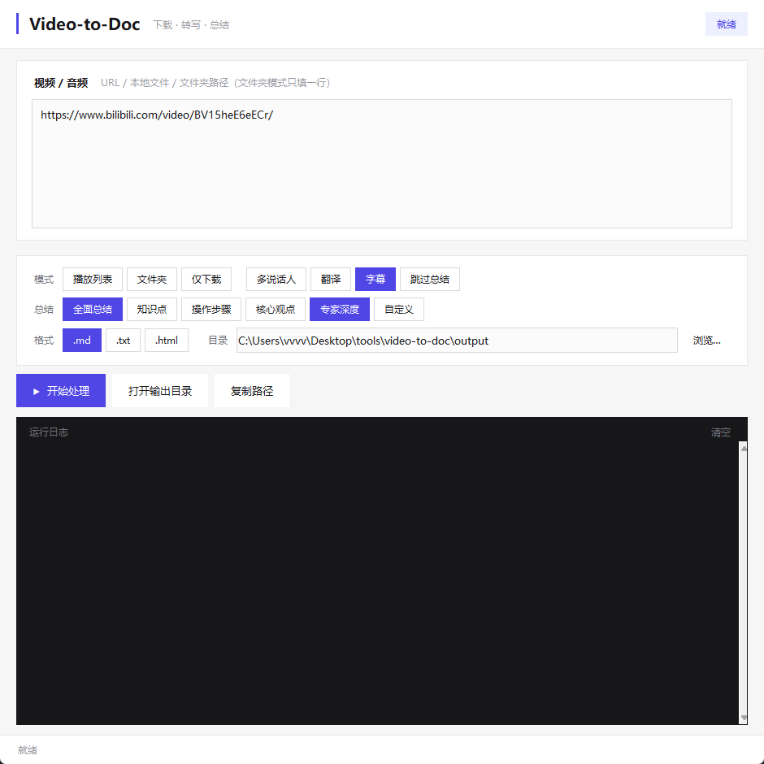

# Video-to-Doc

一键将网络视频（B站、YouTube 等）或本地视频/音频文件转写为文字文档，并用 AI 自动生成内容总结。



## 功能

- **图形界面** — `python gui.py` 启动，粘贴链接即可，支持实时彩色日志、随时停止
- **自动环境** — 自动使用项目虚拟环境，无需手动激活
- **语音转文字** — 基于 faster-whisper，本地 GPU 加速（CTranslate2），VAD 自动跳过静音提速，支持热词增强和初始提示词
- **字幕优先** — 优先提取视频平台字幕（YouTube/B站），质量达标则跳过 Whisper 转写，大幅节省时间
- **章节提取** — 自动提取视频章节标记（YouTube/B站），注入转写文档作为分段标题
- **标点与分段** — LLM 自动为转写文本添加标点符号并按语义分段
- **多说话人识别** — 抛光时由 LLM 根据对话上下文自动识别不同说话人并标注，无需额外依赖
- **翻译** — 外文视频翻译为目标语言，生成汉化文档
- **字幕生成** — 生成 SRT 字幕文件，可配合翻译生成目标语言字幕
- **AI 总结** — 兼容 OpenAI 接口（支持 DeepSeek、MiMo、智谱、通义千问、月之暗面、Ollama），5 种内置总结风格 + 自定义提示词，可同时多选，忠于原文不编造
- **多格式输出** — 转写和总结可按需输出 `.md` `.txt` `.html`，HTML 支持暗色模式、TOC 导航
- **播放列表** — 支持 B站合集/分P、YouTube 播放列表等批量处理
- **断点续跑** — 中断后重跑会跳过已完成的下载/转写；整条流水线已完成的任务会直接跳过（想重跑请删除该任务目录或其中的 `.pipeline_state`）
- **环境诊断** — `python main.py --check` 一键检查 ffmpeg、模型、API、GPU
- **跨平台** — Windows / Mac / Linux

## 系统要求

- Python 3.10+
- ffmpeg（音频提取）
- NVIDIA 显卡（推荐，CPU 也可运行但较慢）

## 快速开始

### 1. 安装 ffmpeg

```bash
# Windows
winget install Gyan.FFmpeg

# Mac
brew install ffmpeg

# Linux
sudo apt install ffmpeg
```

### 2. 克隆并初始化

```bash
git clone <repo-url> video-to-doc
cd video-to-doc
python setup.py
```

首次运行会下载 Whisper 模型（约 1.6GB），仅此一次。之后 `python main.py` 和 `python gui.py` 会自动使用项目虚拟环境，无需手动激活。

需要跑单元测试时，额外安装开发依赖：

```bash
venv/Scripts/pip install -r requirements-dev.txt
venv/Scripts/python -m pytest tests -q
```

### 3. 配置 API Key

```bash
cp .env.example .env
```

编辑 `.env`，填入一行：

```
API_KEY=sk-your-api-key
```

AI 总结和标点分段功能依赖 API。转写功能不依赖 API（仅 faster-whisper 本地运行）。

默认使用 **DeepSeek** API（国内可直接访问，[获取 Key](https://platform.deepseek.com/api_keys)）。在 `config.yaml` 中改 `api_provider` 即可切换服务商：

```yaml
summarizer:
  api_provider: deepseek   # 可选: deepseek / mimo / zhipu / tongyi / moonshot / ollama
```

选好服务商后 `base_url` 和 `model` 会自动填充。也可以手动覆盖。

### 4. 使用

**图形界面（推荐）：**

```bash
python gui.py
```

GUI 操作：
- 输入框填写视频链接、本地文件路径或文件夹路径（每行一个）
- 右键输入框可粘贴、复制、剪切
- 勾选模式：播放列表、文件夹模式（互斥）、仅下载、多说话人识别、翻译、字幕、跳过总结
- 选择总结风格——选"自定义"时显示提示词输入框，可直接在界面中编写
- 点"开始处理"，日志区实时显示进度

**命令行：**

```bash
# 在线视频
python main.py "https://www.bilibili.com/video/BV1xx411x7xx"

# 本地视频/音频文件
python main.py "C:/videos/myvideo.mp4"

# 文件夹批量处理
python main.py --folder "C:/videos/教程合集"

# 播放列表
python main.py "https://www.youtube.com/playlist?list=xxx" --playlist

# 多说话人识别
python main.py "https://example.com/video" --multi-speaker

# 指定总结风格（可多选）
python main.py "https://example.com/video" --summary-styles auto,expert,knowledge_points

# 翻译 + 生成字幕
python main.py "https://example.com/video" --translate --srt

# 仅转写，跳过总结
python main.py "https://example.com/video" --skip-summary

# 环境诊断
python main.py --check
```

## 输出结构

```
output/
└── {标题}/
    ├── {标题}.mp4         # 原始视频（在线）或副本（本地）
    ├── {标题}.md          # 转写文档（已加标点分段）
    ├── {标题}.html        # 转写文档（仅选中 html 时）
    ├── {标题}.srt         # SRT 字幕（启用字幕时）
    ├── 全面总结-{标题}.md # AI 总结（风格名作为前缀）
    └── 专家深度-{标题}.md
```

中间文件（`.txt`、`_subtitle.srt`、`_subtitle.vtt`、`_subtitle_info.json`、`_zh.txt`）在任务完成后自动清理；
`_segments.json` 会**保留**——它是重跑字幕、低置信质检和免重转的凭据（删掉它才会触发重新转写）。

**播放列表 / 文件夹批量处理：**

```
output/
└── {合集或文件夹名}/
    ├── {视频1标题}/
    │   ├── {视频1标题}.md
    │   └── 全面总结-{视频1标题}.md
    ├── {视频2标题}/
    │   └── ...
    ├── 转写汇总/          # 所有视频的转写文件集中于此
    └── 总结汇总/          # 所有视频的总结文件集中于此
```

## 总结风格

一共 5 种内置风格 + 自定义，可以**同时多选**，每种风格生成一个独立的总结文件。

| 风格 | 参数 | 说明 |
|------|------|------|
| 全面总结 | `auto` | 精炼文章式：核心观点 → 论证展开 → 关键收获（默认） |
| 知识点提取 | `knowledge_points` | 结构化列出全部知识点，含概念解释、重要性说明、原文例子 |
| 操作步骤 | `steps` | 按顺序拆解步骤：做什么、为什么必要、怎么做、常见坑点 |
| 核心观点 | `core_ideas` | 洞察提炼：拒绝话题罗列，每条都是让人「原来如此」的观点 |
| 专家深度 | `expert` | 世界级专家视角，自我核查事实，锐利批判思维 |
| 自定义 | `custom` | 不走内置提示词，改用 `summarizer.custom_prompt` 中的内容 |

在 GUI 中勾选"自定义"时会显示提示词输入框，可直接在界面中编写。

## 支持的格式

| 类型 | 扩展名 |
|------|--------|
| 视频 | `.mp4` `.mkv` `.webm` `.flv` `.avi` `.mov` |
| 音频 | `.mp3` `.wav` `.m4a` `.flac` `.ogg` `.aac` `.opus` `.wma` |

音频文件直接送入 Whisper 转写，跳过 ffmpeg 提取步骤。

## 配置

编辑 `config.yaml`：

| 配置项 | 说明 | 默认值 |
|--------|------|--------|
| `output_dir` | 输出目录（CLI 可用 `-o` 覆盖） | `./output` |
| `downloader.quality` | 画质：`best` / `1080p` / `720p` / `audio`（只下音频，最快） | `best` |
| `downloader.timeout` | 单次下载总超时（秒） | `7200` |
| `downloader.slow_node_retries` | 抽到慢 CDN 节点时最多重取几次下载地址（`1` = 关闭换节点） | `3` |
| `downloader.slow_node_min_speed_kb` | 低于此速度视为慢节点（`0` = 关闭慢节点检测） | `300` |
| `downloader.slow_node_min_bytes_mb` | 已下载不足此大小不做慢节点判定 | `8` |
| `downloader.slow_node_min_samples` | 连续多少个采样点都慢才判定（约等于秒数） | `5` |
| `whisper.language` | 转写语言（`auto` 只按前 30 秒判定，中文视频建议写 `zh`；CLI 可用 `--language` 覆盖） | `zh` |
| `whisper.device` | 推理设备（GPU 不可用时自动回退 CPU；CLI 可用 `--device` 覆盖） | `cuda` |
| `whisper.compute_type` | 精度 | `float16`（GPU）/ `int8`（CPU） |
| `whisper.vad_enabled` | VAD 语音检测，自动跳过静音 | `true` |
| `whisper.beam_size` | 束搜索宽度，越大越准越慢 | `5` |
| `whisper.condition_on_previous_text` | 是否用上一段结果作为上下文。中文长音频设为 `false` 可消除重复环 | `false` |
| `whisper.audio_format` | 从视频提取的中间音频格式 | `wav` |
| `whisper.hallucination_silence_threshold` | 静音段幻觉过滤阈值（秒），`null` 表示关闭 | `null` |
| `whisper.initial_prompt` | 初始提示词，帮助识别专业术语 | 空 |
| `whisper.hotwords` | 热词增强，逗号分隔的专有名词（CLI 可用 `--hotwords` 覆盖） | 空 |
| `summarizer.api_provider` | API 服务商 | `deepseek` |
| `summarizer.base_url` | 自定义 API 地址（留空用预设） | 空 |
| `summarizer.model` | 自定义模型（留空用预设） | 空 |
| `summarizer.polish_model` | 标点分段专用模型（留空复用 model） | 空 |
| `summarizer.max_chunk_chars` | 长文本分段阈值 | `80000` |
| `summarizer.max_tokens` | 单次回复最大 token（含推理模型的思考预算） | `8192` |
| `summarizer.timeout` | API 超时（秒） | `300` |
| `summarizer.max_retries` | API 失败重试次数 | `3` |
| `summarizer.polish_max_tokens` | 标点分段单次回复最大 token | `16384` |
| `summarizer.polish_timeout` | 标点分段 API 超时（秒） | `120` |
| `summarizer.summary_styles` | 总结风格列表（可多选） | `[auto]` |
| `summarizer.custom_prompt` | 自定义总结提示词 | 空 |
| `summarizer.multi_speaker` | 多说话人识别 | `false` |
| `summarizer.output_formats` | 输出格式 | `[md]` |
| `translation.target_lang` | 翻译目标语言 | `zh` |
| `subtitles.enabled` | 优先提取视频平台字幕 | `true` |
| `subtitles.languages` | 字幕语言优先级 | `[zh, zh-Hans, zh-Hant, en]` |
| `subtitles.prefer_manual` | 优先人工字幕 | `true` |
| `subtitles.auto_subtitle.min_coverage` | 自动字幕最低覆盖率 | `0.50` |
| `subtitles.auto_subtitle.max_noise_ratio` | 自动字幕最大噪音占比 | `0.10` |
| `downloader.quality` | 视频清晰度预设 | `best` |
| `downloader.format` | 高级自定义 yt-dlp 格式串（留空用 quality） | 空 |
| `downloader.cookies_file` | Cookie 文件路径（B站需登录时填，如 `cookies.txt`） | 空 |
| `downloader.cookies_from_browser` | 直接从浏览器读取 Cookie：chrome/firefox/edge | 空 |
| `downloader.proxy` | 代理地址 | 空 |
| `downloader.timeout` | 下载超时（秒） | `7200` |

### API 服务商预设

| `api_provider` | 服务商 | 说明 |
|---|---|---|
| `deepseek` | DeepSeek | 推荐，国内直连，充值 10 元用很久 |
| `mimo` | 小米 MiMo | 1M 上下文，性价比高 |
| `zhipu` | 智谱 GLM | 有免费额度 |
| `tongyi` | 通义千问 | 有免费额度 |
| `moonshot` | 月之暗面 | |
| `ollama` | Ollama 本地 | 需先安装 Ollama，免费 |

### 视频清晰度预设

| `quality` | 说明 |
|---|---|
| `best` | 最高画质（不做限制） |
| `2160p` | 4K 以内 |
| `1080p` | 1080p 以内 |
| `720p` | 720p 以内 |
| `480p` | 480p 以内 |
| `360p` | 360p 以内 |
| `audio` | 仅音频（不下载视频画面） |

## 常见问题

**Q: 启动 GUI 无反应？**
A: 确保已运行 `python setup.py` 完成初始化。用命令行 `python gui.py` 启动可看到错误信息。

**Q: GPU 不可用？**
A: 自动回退到 CPU。运行 `python main.py --check` 诊断。确保 NVIDIA 驱动已安装。

**Q: 下载失败？**
A: 更新 yt-dlp：`venv/Scripts/pip install -U yt-dlp`

**Q: B站视频下载失败（412 错误）？**
A: B站 现在要求登录才能下载。两种方式：
1. 安装 [Get cookies.txt](https://chromewebstore.google.com/detail/get-cookiestxt-locally/cclelndahbckbenkjhflpdbgdldlbecc) 浏览器扩展 → 登录 B站 → 导出 cookies.txt → 配置 `downloader.cookies_file: "cookies.txt"`
2. 设置 `downloader.cookies_from_browser: edge`（需先关掉 Chrome，Edge 下有时需 cookies.txt 兜底）

**Q: 转写文本标点不准？**
A: 标点由 LLM 自动添加。可在 `config.yaml` 中设置 `summarizer.polish_model` 切换模型。

**Q: 多说话人识别效果不好？**
A: 多说话人识别由 LLM 根据对话上下文判断，不依赖声学特征。对问答式对话效果好，对多人同时说话或简短交替效果有限。可在 GUI 中随时开关。

**Q: 如何提高专业术语的识别准确率？**
A: 在 `config.yaml` 的 `whisper.initial_prompt` 中描述音频主题（如"关于深度学习的讲座"），或设置 `whisper.hotwords` 列出专有名词（如"DeepSeek,PyTorch,CTranslate2"）。也可以用命令行临时覆盖：`--language zh --hotwords "构图法则,三分法"`。

**Q: 转写速度能优化吗？**
A: VAD 语音检测默认开启，可自动跳过静音段提速 20-40%。如不需要可设置 `whisper.vad_enabled: false`。

**Q: 视频的章节标记会保留吗？**
A: 会。YouTube/B站视频的章节会自动提取并注入到转写文档中作为 `## 章节标题` 分段标记。

## 已知限制

以下几点是当前实现的上限，不是 bug，使用前请知悉：

1. **ASR 会出现同音错字** — 人名、品牌、专有名词尤其容易错（例如把「阿喀琉斯之踵」听成别的词）。
   `whisper.hotwords` 与 `whisper.initial_prompt` 能显著缓解，但**无法根治**；
   `whisper.language` 建议显式写 `zh` 而不是 `auto`（`auto` 只按前 30 秒判定语言）。
2. **标点与分段由 LLM 完成** — 长视频会被分块处理，极少数情况下分块边界处的语句衔接可能不连贯。
   代码里有保真守卫：一旦抛光结果的长度或相似度异常，会自动回退原文并打 `WARNING`。
3. **`--translate` 依赖 LLM 逐行对齐** — 若翻译输出的行数与原文不一致，会**跳过翻译**而不是让字幕错位，
   日志中会给出 `翻译行数不匹配` 的 WARNING。
4. **视频原文件不会被自动删除** — 下载的 `.mp4` 会一直留在 `output/` 下，需要手动清理 `output/`；
   只有 `.txt`、`_subtitle.*`、`_zh.txt` 这类可再生的中间文件会在任务完成后自动清理（`_segments.json` 保留，供重跑字幕与质检使用）。

## 技术栈

- [yt-dlp](https://github.com/yt-dlp/yt-dlp) — 视频下载
- [faster-whisper](https://github.com/SYSTRAN/faster-whisper) — 语音转文字（CTranslate2 推理引擎，GPU/CPU 自适应）
- [ModelScope](https://modelscope.cn) — 模型下载
- OpenAI 兼容 API — LLM 标点分段 + 多说话人识别 + AI 总结
- [mistune](https://github.com/lepture/mistune) — Markdown → HTML 渲染
- tkinter — 图形界面（Python 内置）
- [pytest](https://docs.pytest.org/) — 单元测试（开发依赖，见 `requirements-dev.txt`）

## 许可

MIT
